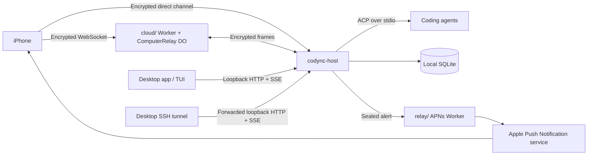

# Architecture

Codync keeps agents and their working files on a computer. Clients address that computer's bots; the host owns execution, transcripts and authorization.

## Runtime paths

The phone tries direct candidates first, with a 1.5-second connection race, then uses the configured cloud relay. Both paths use the same end-to-end encrypted channel. Tailscale is an optional direct route. Loopback bearer credentials are for local applications and SSH forwarding, not phone pairing.

## Ownership and storage

| Data | Owner and location |
|---|---|
| Bots, chats, replies, revisions, authorized devices | Host SQLite in its data directory (`~/.codync` by default; `CODYNC_HOME` overrides it) |
| Host signing and mailbox keys | `identity.json`, separate from SQLite |
| Loopback API bearer token | Host `token` file |
| Agent context and provider credentials | Coding harness on that computer |
| Long-term bot memory | Host SQLite `memory_*` tables (`codync-mem`) |
| Account users, computer ownership, devices and grants | `cloud/` D1 |
| Presence, host-signed ACL, offline encrypted mailbox | Per-computer `ComputerRelay` Durable Object |
| Phone remote-device signing and push keys | Keychain, partitioned by account context |
| Desktop account token and cloud device key | App data, encrypted with Electron `safeStorage` |
| Client mirror, widget snapshots, selected computer | Per-account cache/App Group storage |
| APNs signing key and ticket encryption key | `relay/` Worker secrets |

Cloud account metadata includes names, public keys, ownership and access state. Chat/channel contents and notification title/body are encrypted. Routing IDs, timing and sizes remain visible to the relevant service; “end-to-end encrypted” does not mean all metadata is hidden.

## Host owns the logic

Product logic and heavy work run once, in the Rust host. The iPhone app, the desktop app and the terminal UI are views over host state: logic in one client would need a copy in the others, and the copies drift.

The host owns:

- Bots, chats, sessions and agent processes: creating, configuring, starting, idling and resuming them.
- MCP servers and connectors: installing them, parsing pasted configs, sign-in, and handing them to agents.
- Conversation rules: groups, replies, mentions, collaboration and queueing.
- Routines, memory, usage, bot order, voice-call credentials, remote screen signaling and push sealing.
- Validation, state every client shows the same way, and anything that spawns processes or touches the computer's files.

Clients keep:

- Rendering, input and animation; UI-only state (drafts, scroll position, selection, open sheets); optimistic display that host events then confirm or replace.
- Work only the device can do. On iPhone: microphone and speech, Keychain, APNs registration, push decryption in the notification extension, end-to-end channel crypto and widgets. In the desktop main process: installing and controlling the host service, SSH tunnels, the speech helper, Codync Screen registration and app updates.

When a client needs data or behavior the host doesn't offer, add a host method or event (additive; see [compatibility](../reference/compatibility.md)) and use it from every client. Never rebuild it inside one client.

## Host execution

`api/` and `remote/channel.rs` share dispatch and caller checks. `hub.rs` coordinates actors and event publication; `store/` persists mutations and the global revision. Clients catch up from `rev`, then follow events. Duplicate sends are identified by `clientNonce`.

`agent/bot/` serializes each bot's turns and owns its ACP process. Its chat and group turns use its main session; each routine run has one of its own. Group turns are queued on member bots; the group itself has no harness. See [groups and replies](../features/groups-and-replies.md), [collaboration](../features/bot-collaboration.md) and [context/memory](../features/context-and-memory.md).

## Client state and routing

- On iPhone, `AccountSession` owns Clerk integration; `AccountStore` owns one account context's computer stores.
- `BotReference(accountId, computerId, botId)` identifies a destination. Widgets and pushes carry account/computer scope.
- `BotStore` mirrors one computer and consumes a `HostTransport`: loopback or encrypted channel.
- Account changes retire the old stores; late responses must not update the new context. Signing out erases that context's local credentials and caches.
- The desktop app (`apps/desktop/`) has its own TypeScript `BotStore` and attaches its local host and configured SSH hosts through loopback only ([desktop app](desktop-app.md)). iPhone connections use device identities.

Several computers per account are supported: the iPhone and Android apps pair several, with a heading per computer in the roster, Computer management for each, and each computer's push, usage and widgets; the desktop app attaches its local host and configured SSH hosts. Account-scoped aggregation and SSH build on the same structure (`AccountStore`, `BotReference`).

## Service boundaries

`cloud/` implements `/v1`, Clerk authentication, computer registration/claim, host-approved access, WebSocket relay and mailbox. `relay/` implements APNs registration tickets and push forwarding. [Remote protocol](../reference/remote-relay.md) defines wire details; [Cloudflare testing](../guides/cloudflare-testing.md) distinguishes these paths during acceptance.

Remote screen uses the channel for signaling and WebRTC for media/input. Cloudflare Realtime TURN forwards encrypted media/input when a cloud connection cannot establish a direct WebRTC path. [Remote screen](../features/remote-screen.md) describes the helpers and current limitations.

## Release and environment boundaries

Client/host compatibility uses mutual minimum versions (`minApp` / `minHost`, see [compatibility](../reference/compatibility.md)). The channel wire version (`v=1`), pairing URL version (`v=3`) and the cloud health endpoint's service version are separate values.

The `iOS Dev` scheme (`DevDebug` / `DevRelease`) uses `apps/shared/Config/dev.plist`; `iOS` (`Debug` / `Release`) uses `main.plist`. The desktop app takes the same values through `apps/desktop/tools/account-config.mjs`. The host compiles in its cloud from `CODYNC_ENV` (`main`, else dev), set by the same packaging script (`dist:<platform>:dev` / `dist:<platform>:main`). See [environments](../guides/environments-and-deployment.md).
