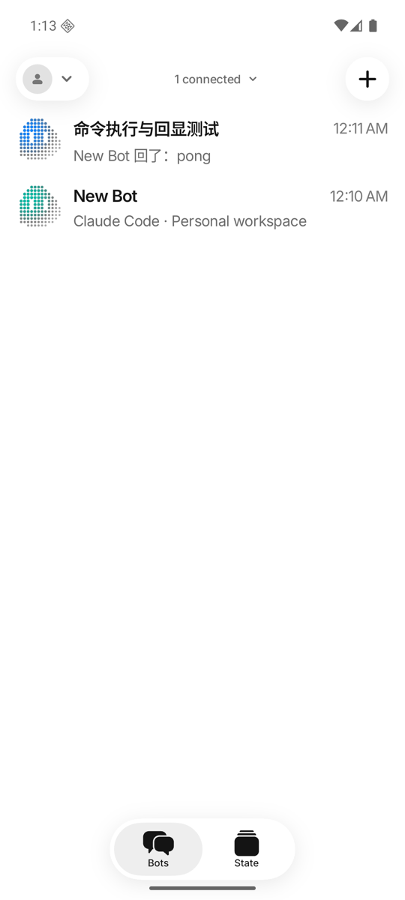
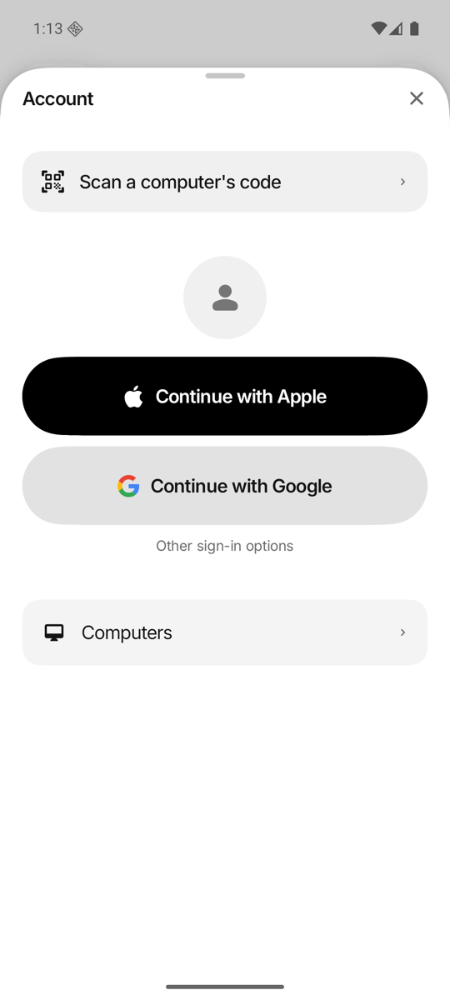

# Android parity and acceptance

Status: **in development, merged into `dev`** (#151, #152, #154, #155), on Google Play internal testing, not public yet. The
Android app is a 1:1 port of the iPhone app: each screen
is built from its iOS source (`apps/ios/Views`, `apps/ios/Kit/Sources/CodyncUI`) with the
Android `design` module (see the [Android README](../../apps/android/README.md)). Product
logic stays in the host. This checklist tracks what's still different and what still needs
acceptance on real devices.

## Coverage

"Ported" means the iOS screen and flow exist on Android and were walked through on an
emulator against a real host; device acceptance is listed separately.

| Area | Android | Remaining |
| --- | --- | --- |
| Welcome/pairing | Ported: welcome crew and chat glimpse, Install (Mac/Linux) and Scan pages with the camera on the page (1080p frames, refocused on the middle every 2.5 s, tap to focus), paste link, Tailscale note, sign-in | Physical optical scan, camera permission denial |
| Accounts/access | Ported: account sheet and switcher, several computers (`AccountStore` with one `AppStore` per computer, as iOS `AccountStore` + `BotStore`), Computer management with a card per computer (connection status, badge color, Revoke this phone's access, older copies removed from the account), account computer access with its code (one request per computer), access banners, `codync-dev://computers` and `codync-dev://plugins` | Provider browser round trip on a device; Revoke and older copies against a signed-in account (covered by cloud request tests only) |
| Roster | Ported: rows, menus, pin/hide/delete, Make lead agent, groups, sections (move to, fold per device, rename, remove), drag to reorder (host-synced order) and TalkBack Move up/down, a heading per computer once there are several (fold, drag to reorder on this phone, its Extensions), the computer filter (show, hide, All computers; stays open while picking), the newer-release reminder, pull to refresh (also in Computer management) | — |
| Conversation | Ported: bubbles, Markdown/code, permissions, reactions, quote replies, Full conversation, bot-to-bot exchange lines and their conversation, routine notices that open their routine, files a bot shares (verified download, then the share sheet), sent images full size, pull down to reconnect, jump to latest, read receipts for every conversation on screen | Physical keyboard and TalkBack |
| Composer | Ported: files/photos/paste (groups too, image thumbnails, Paste only when the clipboard holds files), `/` commands (Fast mode, skills listed fresh on `/`), @mentions in groups, call/send/stop/interrupt button, dictation (the mic, its recording pill, the engine menu beside it: On device through Android's recognizer, or OpenAI / Gemini transcribed on the user's key with *Transcribing…*, and the *Couldn't dictate* dialog) | Dictation with a live microphone and a provider key on a device |
| Bot and group editors | Ported: avatar (a row that unfolds the picker), profile, agent and model options, Fast mode, workspace folder picker, permissions, activity, connectors, skills (with their details); the bot details sheet (`BotDetailsView`, from the chat's title, a routine notice or Add a fallback): Details (instructions, agent, Use the computer, Routines), Library, Memory, Settings (Codync's skill and connector switches), saved as you edit, Create template; a group's title opens its editor. An agent's own skills, connectors, rules and plugins are on its sheet in Extensions, under Sign in | — |
| Memory | Ported, read-only (`MemoryCard.kt`, `MemoryInfoSheet.kt`): About you and This bot with each `MEMORY.md` line and who wrote it, notes and their reader, dreams, the harness's own memory switch (or Shared) and its tab, the info sheets; handoff cards (keep the conversation, edit or unfold what it carries) | — |
| Routines | Ported: list with switches, editor (schedule, webhook panel, run settings), test run, delete | Live provider/routine acceptance |
| Extensions | Ported: agents (install, sign-in, setup terminal, and the skills, connectors, rules and plugins that agent already has), registry connectors, Composio apps, skills, installed list, custom connector, own skill, credentials, chat connection request card | Real provider OAuth, 1Password |
| Voice | Ported: call bar (provider name, fallback notice), the call's notification as an Android call (face, length, hang up, mute; the status bar's call chip), Voice chat settings (engine, mode, models, voice, minutes this month, a dictation-only provider section), on device (the call's language through Android's on-device recognizer, Vosk English as the fallback, replies read by an offline voice for their language), OpenAI Realtime (WebRTC), Gemini Live, Speech mode, fallback to on device, group calls | Both providers with a real key on a device; a live microphone on a device |
| State/widgets | Ported: Widget (with the animated Add a widget guide), Live update and Status bar pages, Usage sheet (one computer at a time: the last active one, with a picker), Choose the look; Provider usage, Claude Code and Codex usage, Usage limits, Bots (every computer's bots) and Team widgets with launcher Edit widget and picker previews (Android 15+); the Bots Quick Settings tile (iOS's Control Center control) | Physical launcher refresh |
| Notifications | Ported: alerts as conversations with the bot's face (a group's face and its speaking member), conversation shortcuts, what happened ("Task complete") as sub text | Android's conversation layout doesn't draw sub text; background delivery needs FCM in the deployment |
| Live updates | Android 16 Live updates (`ProgressStyle`), the status bar chip on Android 16 QPR1 (API 36.1) | Background updates need FCM in the deployment |
| Version check | `VersionMismatch.MIN_HOST`, the host's `minApp`, the update card in the roster and in place of the composer (Update Codync opens Google Play; greyed out while Play doesn't have the version yet), the newer-release reminder (`AppUpdates.kt`, Play's in-app update info) | Set `MIN_HOST` to the first release that ships Android support when it's cut |
| Remote screen | Ported: viewer from Computers, the chat header (watch a bot, then take over) and `codync-dev://screen`; WebRTC H.264, trackpad and direct touch, long-press drag, two-finger scroll, pinch zoom streaming the visible region, keyboard with IME and modifier keys, clipboard, displays, take over/hand back, Rotate, trickle ICE that keeps the video through a channel reconnect | Pinch, IME composition and a hardware keyboard on a device; TURN relay path and renewal |
| Analytics | Ported: PostHog feature events with the Settings switch (and its sheet), crash reports sent on the next launch; Rate on Google Play and Report an issue | The rating invitation, with the Play release |
| Packaging | Debug, R8 release signed with the Play upload key, `versionCode` from the version, Firebase (`codync-auth`) and private configuration, `Submit Android` to Google Play (internal testing since 2.24.0) | Production access (closed test), see [Before a Play release](#before-a-play-release) |

## Gates before merge into dev

- [x] `./gradlew :core:test :app:testDebugUnitTest :app:assembleDebug :app:assembleDebugAndroidTest :app:assembleRelease :app:lintDebug` passes (CI and the pre-commit hook run it).
- [x] Every screen above walked through on an API 36 emulator against a disposable host, in light and dark mode, side by side with the iOS simulator.
- [x] Live update and its status bar chip on an API 36.1 emulator.
- [x] `AppStore.kt` split by responsibility (clean-code size rule), undecodable events stop after one rewind and show *Update this app*, timeouts surface as errors.
- [x] Instrumentation suite run on an emulator (2026-11-01: 134 tests, all passing): through `am instrument`, because Gradle's connected run uninstalls the paired app, on an AVD with `hw.keyboard=yes` (`TerminalSurfaceTest` needs a hardware keyboard) and no System UI dialog in front; the `Live*` probes skip without their host.

## Not done yet

Where the Android app still falls short, as of 2026-11-01. Everything else in the table above
was walked through on an emulator against a real host (several computers: two disposable hosts
on one emulator, 2026-10-31). The account flows were walked on 2026-11-01 against the dev cloud, with the emulator
signed into a worktree sandbox's test account (`npm run phone-account`, [Dev app isolation](../guides/dev-app.md#worktree-sandboxes)):
the sandbox computer in the account, Ask for access approved on the computer, *Revoke this phone's access* (the cloud
grant is revoked, the card goes back to *Ask for access*), and an older copy of the computer shown as such. Push delivery was walked on 2026-11-01: a debug build with Firebase
(`-PcodyncGoogleServicesFile=<google-services.json>`) on the Google APIs emulator, killed, got a bot's
*Task complete* alert through the dev relay and FCM (pushes wait while any phone, an iOS simulator
included, is connected to that computer).

### Not verified (needs an account, a key, a device or the real Mac)

Every row is ported. On 2026-11-01 the owner put off the remaining checks: OpenAI until a valid key is saved,
Speech mode until a phone can speak into its microphone (no sound from the Mac), the physical-device rows until
device acceptance, and the account flows on main (they were walked on dev; main has had the same
`0004_android_devices` migration since the 2.34.0 merge, but no Android phone has signed in against it yet).

| What | Code | What it needs |
| --- | --- | --- |
| Push on a phone running the Play build, and the background Live update refresh | `PushService.kt`, `AppStoreNotifications.kt` | A phone with the official build; alert delivery through FCM is verified on the emulator |
| OpenAI Realtime and Speech mode with a real key | `WebRtcPeer.kt`, `core/.../OpenAIRealtimeEngine.kt`, `CloudSpeechEngine.kt` | A valid OpenAI key on the paired computer. Gemini Live was walked on 2026-11-01: the session reached Gemini's `setupComplete` and listened, on the key saved on Codync Dev. The OpenAI key saved on the production host was rejected (*Incorrect API key*), and the call fell back to on-device voice with its notice |
| Remote screen: Chinese IME composition, a hardware keyboard, the TURN relay path and its credential renewal | `ScreenKeys.kt`, `ScreenSession.kt`, `ScreenView.kt` | A computer it's safe to type into, and a signed-in host for the relay; viewing, trackpad and pinch zoom are verified |
| On-device voice with a live microphone | `PlatformSpeech.kt`, `LocalVoiceAudio.kt` | A phone; on the emulator the recognizer was fed the speech fixture |
| Camera QR pairing (focus and 1080p frames), launcher widget refresh, foldables, TalkBack end to end | `QrViewfinder.kt`, `CodyncWidgets.kt` | Physical devices; portrait lock with the rotating screen viewer, 130% text and TalkBack's Move up/down were checked on the emulator |
| Update info from Google Play itself | `AppUpdates.kt` | An install from Google Play (a debug build gets none); `AppUpdatesTest` drives the update reminder and *Update Codync* through Play's `FakeAppUpdateManager` |

### Different from the iPhone on purpose or by platform

- **Notification subtitle**: "Task complete" / "Response needed" / "Task failed" is the
  notification's sub text, which Android's conversation layout doesn't draw (`PushService.kt`).
- **Bots tile** refreshes when Quick Settings opens, not live (it picks its bot as the iPhone's control does:
  waiting for you, then working, then the most recent, `core/.../WidgetFeed.kt` `mostUrgentBot`).
- **Shared files**: leaving the chat during a download skips the share sheet when it finishes
  (the card shows *Downloaded*); shared copies are deleted after a day (`AppStoreFiles.kt`,
  `AttachmentFiles.kt`).
- **Pull to refresh** on the roster and in Computer management uses the chat's indicator; iOS uses the system one.
- **Shortcuts actions** (Open Live Mode, Send Text to Bot) are Apple App Intents; Android's counterparts are
  **Talk to Codync** in the app icon's shortcuts (the lead, by Settings → Shortcuts → Lead to call) and text shared
  from another app, which opens the picked bot's chat with the text in its box ([iOS Shortcuts](../features/ios-shortcuts.md), `LiveShortcut.kt`, `ShareToBot.kt`).
- **On-device voice**: languages other than English need Android 13+ and Android's on-device
  recognizer; it never falls back to online recognition (iOS may use Apple's servers).
- **Jump to latest** is an opaque disc: it sits in the scrolling content, so there's no blur under it.
- **Dictation on device** stops at a pause, like the iPhone's; Android's recognizer runs on the phone where it can (it tries the phone's own speech service once when that one lacks the language), otherwise the phone's own speech service.

## Before a Play release

Set up on 2026-10-24 ([Android releases](../guides/development.md#android-releases-google-play)): the
Play Console app with every App content declaration (Data safety included), the store listing in
en-US and zh-TW, the upload key and Play App Signing, the `codync-play` publisher, Firebase and the
relay's `FCM_SERVICE_ACCOUNT`, Clerk's Android redirects, and 2.24.0 on internal testing
(tester list `codync-testers`). The listing reuses the App Store's copy (its subtitle as the short
description) and the App Store screenshot deck's Android twin (`marketing/app-store-screenshots`,
Android tab: the same captions over Android captures, *Follow along in the status bar* in place of
the Dynamic Island) with its feature graphic, per language.

- [ ] Closed test: the account is personal, so production access needs a closed test (track
  `alpha`) with at least 12 testers opted in for 14 days in a row, then the application in
  Play Console. Set the repository variable `PLAY_TRACK=alpha` once it runs, then run
  `Submit Android` by hand with the current version and `alpha` (it moves the version Play
  already has there) or promote it in Play Console.
- [ ] Account deletion inside the app: Play requires it for apps that create accounts. Today an
  account is deleted on request (`codync.dev/privacy#delete-account`, by email); add a *Delete
  account* action (cloud method that deletes the Clerk user, whose webhook already removes the
  rest) to every client.
- [ ] Reviewer access: pairing needs a computer, so review needs a way in (a demo video of
  pairing and a chat, or a reusable demo host), linked from App content → Login details.
- [ ] The foreground service video Play asks for the microphone and media playback services
  (voice calls), if it asks when the release goes to review.
- [ ] Physical upgrade keeps the saved account, pinned keys, bots and history.
- [ ] Physical portrait/landscape/foldable, keyboard, large text and TalkBack.
- [ ] Provider sign-in/switching, failed sign-out and revocation.
- [ ] Push on a device with the official Firebase configuration (credentials verified with a
  dry-run send; no device delivery yet).
- [ ] Set `MIN_HOST` to the first release that ships Android support.
- [ ] Host release gating for Android: like iPhones and the App Store, a release that raises
  `minApp` must wait while paired Android phones can't get that version from Play
  ([compatibility](../reference/compatibility.md)).
- [ ] Move the default push relay URL into `apps/shared/Config/{dev,main}.plist` (iOS reads
  them as `AccountConfig.plist`), so the Android build stops parsing the iOS kit's
  `SharedStore.swift` and iPhone-only edits there stop counting as Android changes.
- [x] *Rate on Google Play* and *Report an issue* in the Settings tab, since 2026-10-31.
- [ ] The rating invitation through Play's in-app review API, with the iPhone's policy
  ([review invitation](../features/ios-review-invitation.md)): left out until the app is on Google Play.
- [ ] *Release to production* permission for `codync-play`, then `PLAY_TRACK=production`.

## Shared deployment

The host accepts Android pairing (older hosts refuse it, and the app asks to update
Codync on the computer) and counts Android event streams as connected phones, so
pushes are held while one is open. The cloud accepts Android device records through
the `0004_android_devices.sql` migration, applied by hand to dev and, right after the 2.34.0 merge, to main on 2026-11-01
(the merge and `deploy:main` run no migrations, [migration log](../guides/environments-and-deployment.md#migration-log)).
The push Worker needs the matching Firebase
service account as an external secret; the client configuration contains no private key.

