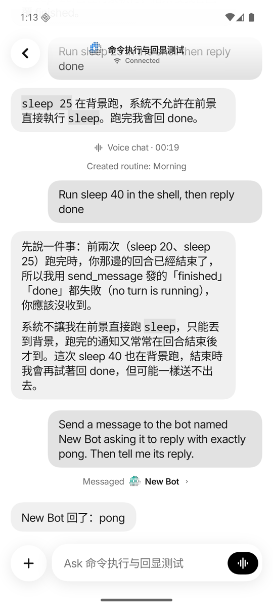

# Android parity and acceptance

Status: **in review** (PR #151). The Android app is a 1:1 port of the iPhone app: each screen
is built from its iOS source (`apps/ios/Views`, `apps/ios/Kit/Sources/CodyncUI`) with the
Android `design` module (see the [Android README](../../apps/android/README.md)). Product
logic stays in the host. This checklist tracks what's still different and what still needs
acceptance on real devices.

## Coverage

"Ported" means the iOS screen and flow exist on Android and were walked through on an
emulator against a real host; device acceptance is listed separately.

| Area | Android | Remaining |
| --- | --- | --- |
| Welcome/pairing | Ported: welcome crew and chat glimpse, Install (Mac/Linux) and Scan pages with the camera on the page, paste link, Tailscale note, sign-in | Physical optical scan, camera permission denial |
| Accounts/access | Ported: account sheet and switcher, Computers & settings, account computer access with its code, access banner | Provider browser round trip on a device; one computer per phone ([multiple computers are future work](../architecture/overview.md)) |
| Roster | Ported: rows, menus, pin/hide/delete, groups, drag to reorder (host-synced order), computer header | Multiple computers |
| Conversation/threads | Ported: bubbles, Markdown/code, permissions, reactions, threads, Full conversation, bot-to-bot exchange lines and their conversation, routine notices | Physical keyboard and TalkBack |
| Composer | Ported: files/photos/paste, `/` commands (Fast mode, New session, skills), @mentions in groups, call/send/stop button | — |
| Bot and group editors | Ported: avatar, profile, agent and model options, Fast mode, workspace folder picker, permissions, activity, connectors, skills | — |
| Memory | Ported: search, filters, add/edit, pin, review, history and timeline, export/import, forget all | — |
| Routines | Ported: list with switches, editor (schedule, webhook panel, run settings), test run, delete | Live provider/routine acceptance |
| Extensions | Ported: agents (install, sign-in, setup terminal), registry connectors, Composio apps, skills, installed list, custom connector, own skill, credentials, chat connection request card | Real provider OAuth, 1Password |
| Voice | Ported: call bar (provider name, fallback notice), Voice chat settings (engine, mode, models, voice, minutes this month), on device (Vosk English + Android TTS), OpenAI Realtime (WebRTC), Gemini Live, Speech mode, fallback to on device, group calls | Both providers with a real key on a device; on-device recognition in languages other than English |
| State/widgets | Ported: Widget (with the animated Add a widget guide), Live update and Status bar pages, Usage sheet, Choose the look; Provider usage, Usage limits, Bots and Team widgets with launcher Edit widget and picker previews (Android 15+); the Bots Quick Settings tile (iOS's Control Center control) | Physical launcher refresh; the tile opens Codync, not Computers, when no bot is at work |
| Notifications | Ported: alerts as conversations with the bot's face (a group's face and its speaking member), conversation shortcuts, what happened ("Task complete") as sub text | Android's conversation layout doesn't draw sub text; background delivery needs FCM in the deployment |
| Live updates | Android 16 Live updates (`ProgressStyle`), the status bar chip on Android 16 QPR1 (API 36.1) | Background updates need FCM in the deployment |
| Version check | `VersionMismatch.MIN_HOST`, the host's `minApp`, the update card in the roster and in place of the composer | Set `MIN_HOST` to the first release that ships Android support when it's cut |
| Remote screen | Ported: viewer from Computers, the chat header (watch a bot, then take over) and `codync-dev://screen`; WebRTC H.264, trackpad and direct touch, long-press drag, two-finger scroll, pinch zoom streaming the visible region, keyboard with IME and modifier keys, clipboard, displays, take over/hand back, Rotate | Pinch, IME composition and a hardware keyboard on a device; TURN relay path and renewal |
| Analytics | Ported: PostHog feature events with the Settings switch (and its sheet), crash reports sent on the next launch | — |
| Packaging | Debug, unsigned R8 release, CI, optional Firebase/private configuration | Play signing, distribution, `versionCode` policy |

## Gates before merge into dev

- [x] `./gradlew :core:test :app:testDebugUnitTest :app:assembleDebug :app:assembleDebugAndroidTest :app:assembleRelease :app:lintDebug` passes (CI and the pre-commit hook run it).
- [x] Every screen above walked through on an API 36 emulator against a disposable host, in light and dark mode, side by side with the iOS simulator.
- [x] Live update and its status bar chip on an API 36.1 emulator.
- [ ] `AppStore.kt` split by responsibility (clean-code size rule), undecodable events stop after one rewind and show *Update this app*, timeouts surface as errors.
- [ ] Instrumentation suite run on an emulator.

## Before a Play release

- [ ] Physical upgrade keeps the saved account, pinned keys, bots and history.
- [ ] Physical portrait/landscape/foldable, keyboard, large text and TalkBack.
- [ ] Provider sign-in/switching, failed sign-out and revocation.
- [ ] Firebase project and the push Worker's `FCM_SERVICE_ACCOUNT` secret (owner's go-ahead).
- [ ] Host release gating for Android: like iPhones and the App Store, a release that raises
  `minApp` must wait while paired Android phones can't get that version from Play
  ([compatibility](../reference/compatibility.md)).

## Shared deployment

The host accepts Android pairing (older hosts refuse it, and the app asks to update
Codync on the computer) and counts Android event streams as connected phones, so
pushes are held while one is open. The cloud accepts Android device records through
the `0004_android_devices.sql` migration. The push Worker needs the matching Firebase
service account as an external secret; the client configuration contains no private key.

