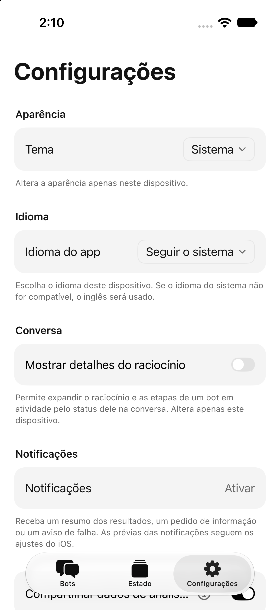
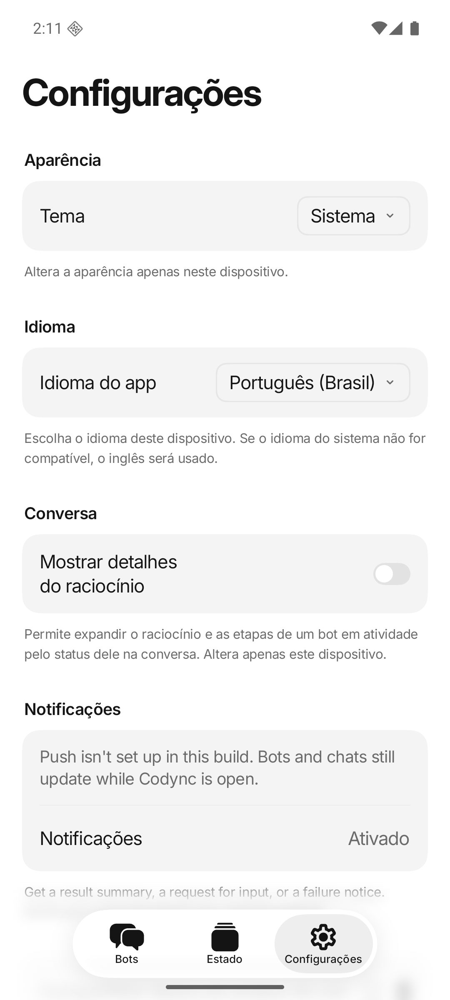

# Brazilian Portuguese acceptance — 2026-11-03

PR: [#318](https://github.com/leepokai/Codync/pull/318). External head reviewed:
`dc3e0323c5802d09fb6086efc9173c811d3c1eae`, based on `bdc60bd9` of `dev`.

## Review

The complete diff, 1,521 catalog entries, PR text, commits and discussion passed
independent code-security and prompt-injection checks. Three read-only reviews
and a verifier found no remaining correctness blocker in the locale registration.
Catalog keys and interpolation tokens match the current shared source.

Maintainer follow-up removes the TUI help's fixed language count and adds Android
to the manual's selection instructions. Other clients have no corresponding
fixed-count help text. Version 2.37.0 is already released, so manifests, locks,
generated Xcode settings and both phones' bilingual notes now use 2.38.0.
`CURRENT_PROJECT_VERSION` and compatibility floors are unchanged.

## Local checks

- Desktop: typecheck and all 381 tests passed.
- iOS: 11 AppLanguage tests passed on the isolated iPhone 17 / iOS 27.0
  simulator; the signed iOS Dev simulator build passed.
- Android: 217 core and 89 app unit tests passed; Debug APK and lint passed.
- Host: pinned Rust 1.99.0 formatting and all nine TUI locale tests passed.
- User manual: 18 pages and 105 links validated.

## App walkthroughs

| Client | Observed result |
| --- | --- |
| macOS desktop sandbox | Settings offers Português (Brasil); selecting it updates chrome immediately. Follow system uses this Mac's English. Quitting and relaunching the app preserves Portuguese. Connected to the isolated development host, version 2.38.0. |
| iPhone, Device Hub | Selecting Portuguese updates Settings and the root tabs. Terminating and reopening preserves the choice. Follow system returns English with an English locale and uses Portuguese when launched with Portuguese AppleLanguages/AppleLocale. |
| Android, codync_worktree | Selecting Portuguese updates Settings and the root tabs. Force-stop/reopen preserves the choice. With the preference set to system and the app's Android locale set to pt-BR, Settings displays Seguir o sistema and Portuguese chrome. |
| Terminal, real PTY | LC_ALL=pt_BR.UTF-8 translates the command palette. Cycling the language action reaches Português (Brasil) after Español and saves pt-BR. A new process under an English locale keeps the saved Portuguese choice. |

Desktop and iPhone were operated with Computer Use. Device Hub needed temporary
foreground activation because Stage Manager exposed only its background thumbnail.
Android's emulator was not recognized by the built-in app controller, so its real
UI was operated and inspected through adb under the shared-emulator lock.

The Android screenshot includes existing unwrapped notification/setup copy in
English (`SettingsView.kt`); this is also untranslated in the other existing
languages. It is not a missing key in the new Portuguese catalog. This acceptance
covers selection, locale resolution, persistence and representative layouts;
native tray menus, widgets, physical-device push and Linux/Windows GUI flows were
not walked. Linux/Windows are the same desktop renderer; platform CI builds are
reported separately by GitHub checks.

## Screenshots

