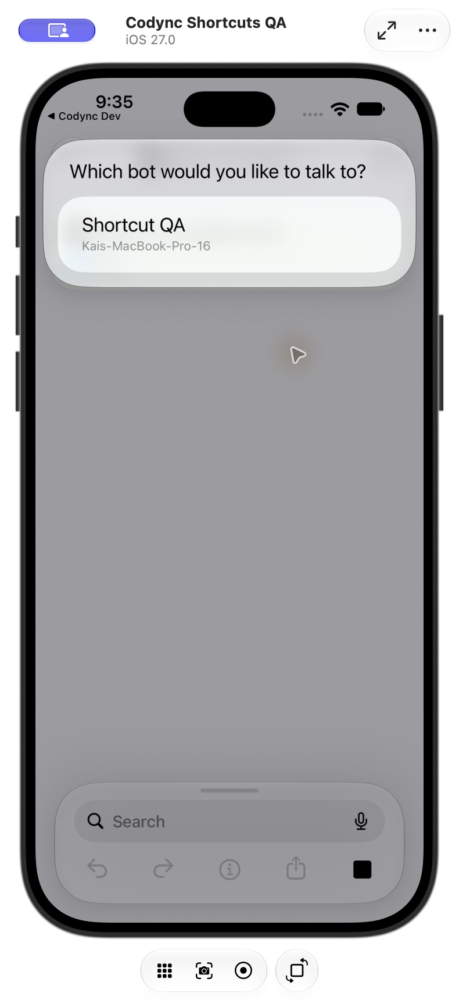
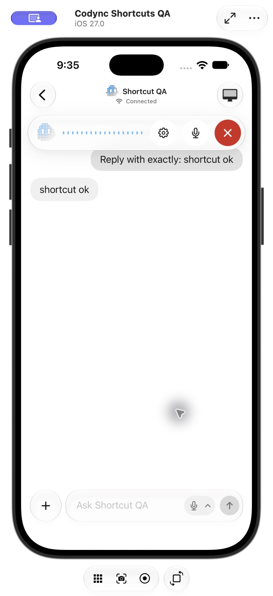

# iOS bot shortcuts: delivery and verification

Verified: 2026-10-23 21:36 America/Los_Angeles. Version: 2.25.0.

This records the original two-action implementation. The later optional Open Chat/background-send behavior is covered by the [follow-up verification report](2026-10-23-2145-background-shortcut.md).

## Result

- **Open Live Mode** accepts a selectable Bot input: a saved bot, shortcut variable or Ask Each Time. It opens the chosen conversation and starts the existing voice call.
- **Send Text to Bot** accepts Bot and Text inputs. It reuses normal sending, nonce deduplication and the offline mailbox, waits for acceptance, and preserves the composer draft. In this original implementation it opened the conversation on each run.
- Both actions are discoverable in iOS Shortcuts. No manual bot ID or URL construction is needed.
- Saved entities carry account and computer scope. Hidden/deleted bots, removed computers and stale selections from another account are rejected.

[User guide](../features/ios-shortcuts.md).

## Automated validation

- iOS Dev / DevDebug build passed for iOS 27.0 Simulator with normal simulator signing.
- CodyncKit-Package: 227 Swift Testing tests passed (106 CodyncUI, 121 CodyncKit).
- New coverage: account isolation, hidden bots, removed computers, delayed target-bot synchronization, global revision gaps, empty input, invalid bots, host refusal, canceled retries, delivery/mailbox acceptance, draft preservation, one-shot Live requests and store retirement.
- Extracted App Intents metadata contains both actions. iOS, host, desktop and lockfile release versions agree.
- `git diff --check` passed.

## Actual-app validation

Xcode Device Hub controlled an independent **Codync Shortcuts QA** simulator paired to this task's isolated real Rust host on port 19387. Production accounts and device credentials were not copied. Host behavior was unchanged; testing reused the compatible existing 2.24.0 development binary.

| Platform / flow | Result | Evidence |
| --- | --- | --- |
| iOS / discover actions | pass | Searching Codync showed Open Live Mode and Send Text to Bot. |
| iOS / Bot input | pass | Picker listed the test bot and computer name; Variables exposed Ask Each Time. |
| iOS / cold-start text send | pass | Terminated Codync Dev, then ran the system shortcut. It showed Message sent; the host stored the user message and the real Codex bot replied `shortcut ok`. |
| iOS / Live with Ask Each Time | pass | Selected a bot at runtime, reached its conversation, completed normal first-use microphone/speech permissions and reached Listening. |
| iOS / existing chat sheet | pass | Opened Full conversation before running Live; the sheet closed and call controls appeared with Listening. |
| iOS / end call | pass | Both calls ended using End call and produced Voice chat duration notices. |
| iOS / offline mailbox | unit-tested | The isolated host had cloud disabled, so real-relay E2E was not run. FakeRemote verified queued is returned only after mailbox acceptance. |
| iOS / remote-screen overlay cleanup | static-reviewed | All stores' screenRequest values are cleared. No remote-screen helper was started to test that branch end to end. |
| Physical iPhone / Siri, lock screen, spoken round trip | not_run | Simulator verification covered Shortcuts and Listening, not physical-device Siri/lock-screen or spoken audio. |
| macOS, Linux, Windows, Android, TUI | not_applicable | This adds an iOS App Intents entry point. Corresponding chat/call implementations were inspected; shared behavior and layouts were unchanged. Only release metadata changed elsewhere. |

The initial text trial failed because the test host was bound only to loopback while advertising LAN/Tailscale routes. After correcting that isolated host setup, final-build cold-start sending and Live passed. No product-code change was needed for that setup issue.

## Review and fixes

The after-change workflow used parallel read-only correctness, completeness and refactor reviews, followed by an independent verifier. Three confirmed issues were fixed: checking for a bot before cold-start synchronization, existing screen/chat presentations obscuring Live, and cancellation not reaching delivery retries.

Verification also identified that the host's global revision can include memory writes absent from the bot/entry stream. The final implementation waits only while the target bot is missing, avoiding a false timeout when that bot has already arrived. Its regression passed; final review found no further substantive issue.

No unrelated refactor was applied. Host APIs and compatibility floors are unchanged. Release metadata was raised from v2.24.0 to 2.25.0 and Traditional Chinese/English What's New entries were added.

## Screenshots

## Handoff limitation

`git pull --rebase --autostash origin dev` completed. Existing commits on the original checkout's branch were not included in this isolated feature branch. `git push origin dev` returned HTTP 403 because the active GitHub account, icework, cannot push to leepokai/Codync. The feature was pushed to its fork branch and submitted as upstream PR #211; it was not merged or released.
