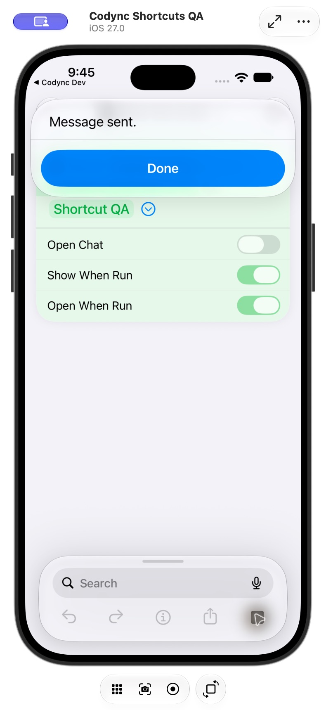
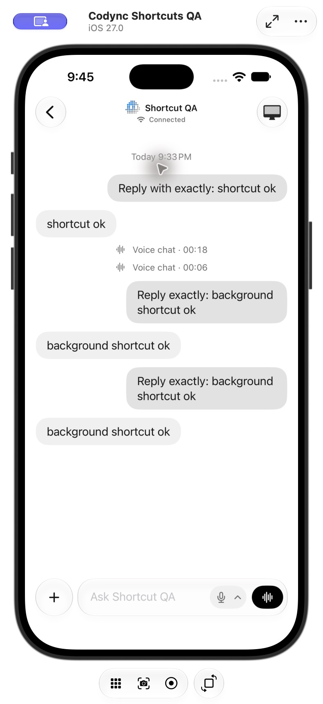

# Optional chat opening for Send Text to Bot

Verified: 2026-10-23 21:45 America/Los_Angeles. Version: 2.25.0.

Worktree: `/Users/kaiwu/.codex/worktrees/ios-bot-shortcuts/Codync`.
Incremental review base: `68afc331`. Delivery: existing upstream PR #211.

## Result

**Send Text to Bot** now exposes **Open Chat**, defaulting to **off**. With it off, the action sends in the background without navigating to a conversation or bringing Codync to the foreground. With it on, the action brings Codync forward and opens the selected bot's conversation. Both paths wait for the existing host/mailbox acceptance result and preserve the composer's draft.

The action uses background/dynamic foreground execution. A pending send holds its target store's connection across background transitions and releases it after acceptance, failure or cancellation. Existing voice calls and concurrent sends retain their own connection holds. Store retirement still forces shutdown.

Background execution waits for Clerk account restoration before resolving the scoped bot. Initial app state preserves the last selected account context while restoration is pending; the restored account is checked again before sending. The action does not select a conversation in background mode.

## Build and regression checks

- iOS Dev / DevDebug build passed for the dedicated iOS 27.0 Simulator.
- CodyncKit-Package: **230 tests passed** (109 CodyncUI, 121 CodyncKit).
- New tests verify background connection startup without chat selection, release after acceptance, preserving an in-flight retry during a background transition, cancellation cleanup, and forced transport closure when a store retires.
- Existing delivery, mailbox, cancellation, draft, account-scope and Live tests remain green.
- `git diff --check` passed. Release metadata remains 2.25.0 because this is a follow-up within the same unmerged release PR.

## Actual-app verification

Xcode Device Hub controlled the dedicated **Codync Shortcuts QA** simulator. It used local pairing to the task's isolated real Rust host on port 19387 and a real Codex test bot. No production credentials or accounts were copied.

| Platform / flow | Result | Evidence |
| --- | --- | --- |
| iOS / configure action | pass | Expanded Send Text to Bot showed Open Chat disabled by default. |
| iOS / cold start, Open Chat off | pass | Terminated Codync Dev, then ran the action from system Shortcuts. Shortcuts remained in front and showed Message sent. The host recorded the exact test text. |
| iOS / Open Chat on | pass | Enabled the switch and ran the same action. Codync opened the selected bot's existing conversation and showed the sent message. |
| iOS / delivery and replies | pass | Host history contained two accepted test messages, and the conversation displayed the real bot's matching replies to both. No new conversation was created. |
| Signed-in Clerk account / cold start | not_run | E2E used local pairing. Actual signed-in account restoration is statically reviewed but was not exercised with an authenticated Clerk session. |
| iOS before 26 | not_run | The foreground-continuation fallback compiled for the iOS 18 deployment target; runtime testing used iOS 27.0. |
| Physical iPhone / Siri, lock screen, relay mailbox | not_run | This run covered system Shortcuts in the simulator and a directly connected host. |
| Other clients | not_applicable | This changes an iOS App Intents option and its device connection lifecycle. Desktop, Android and TUI behaviors need no corresponding UI change. |

## Review

The after-change workflow used three read-only reviewers for correctness, completeness and refactor, then an independent verifier. No substantive incremental defect or worthwhile refactor was identified. The untested signed-in Clerk cold-start path remains explicitly listed above; package tests do not validate it.

## Screenshots

Open Chat off: the send completed while Shortcuts remained in front.

Open Chat on: the selected bot's existing conversation opened, including both test messages and replies.

