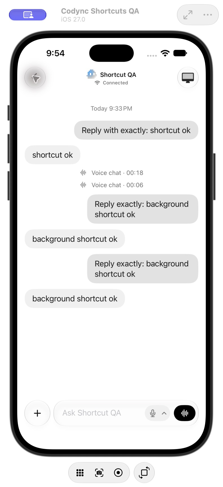
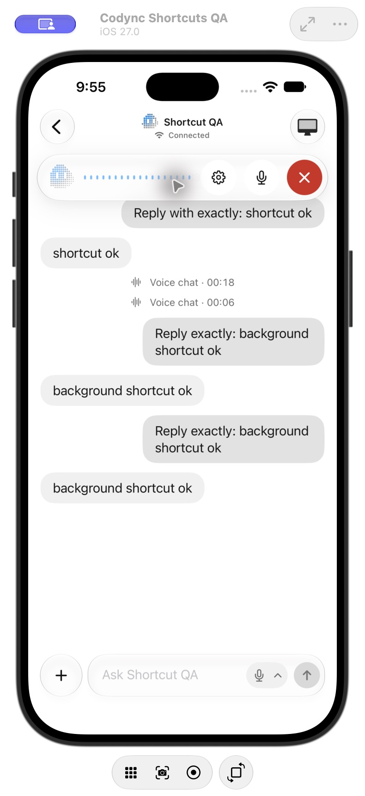

# Live shortcut navigation cancellation verification

Date: 2026-10-23 21:55 America/Los_Angeles

## Result

Fixed [PR #211 review comment #4366013242](https://github.com/leepokai/Codync/pull/211#discussion_r4366013242): leaving a conversation while its Live shortcut waits for a connection invalidates that request. Reopening the bot does not start an abandoned call. A fresh shortcut still starts Live normally.

Each preparation has a unique identity. Changes to the account's selected conversation clear both the preparing identity and any unconsumed call request. A completed connection wait checks that identity before publishing a call request. Retiring a store uses the same cancellation path.

## Automated verification

- `CodyncKit-Package` passed all **231 tests**: 110 CodyncUI and 121 CodyncKit.
- The new parameterized regression ran both navigation paths: return to the bot list and switch to another bot. Both return to the original bot before its delayed data arrives, assert cancellation, verify a new request works once, and verify navigation also clears an already prepared request.
- The iOS Dev / DevDebug build passed on the iOS 27.0 simulator.
- `git diff --check` passed.
- Incremental correctness, completeness and refactor reviews found no remaining mandatory issue. An independent verifier confirmed the original review finding is fixed.

## Device Hub end-to-end verification

Environment: isolated Codync Shortcuts QA iPhone 18 Pro simulator, iOS 27.0; installed final Codync Dev build; locally paired isolated Rust host; system Shortcuts app. The test host was paused only for the connection-delay step and resumed afterward.

1. Ran the saved Open Live Mode shortcut and selected Shortcut QA at runtime.
2. While the host was paused, the conversation displayed Connecting and the normal Call button.
3. Used the native Back button before the connection completed.
4. Resumed the host and reopened Shortcut QA from the connected bot list. The conversation stayed idle with the normal Call button; no Listening or End call control appeared. Shortcuts subsequently reported that the abandoned action was cancelled.
5. Ran a fresh Open Live Mode shortcut, selected the same bot, and observed Listening, Mute and End call controls.
6. Ended the test call and confirmed the normal Call button returned.

| Abandoned request stays idle | Fresh request starts Live |
| --- | --- |
|  |  |

## Scope and remaining checks

This is an iOS navigation fix for its App Intents adapter. Android, desktop and terminal clients do not expose these iOS Shortcuts requests, so their UI and host protocol are unaffected. Version 2.25.0 remains the existing unreleased feature version.

Switching to another bot is covered by the parameterized regression; the real UI run used Back to the bot list. Physical-device Siri and lock-screen execution, a spoken audio round trip, signed-in Clerk cold-start restoration and pre-iOS-26 runtime behavior were not tested in this follow-up. Earlier background-send verification remains documented in [the background shortcut report](2026-10-23-2145-background-shortcut.md).
