<div align="center">


# codync-agent

**Every coding agent, one interface.**<br>
Find, install and run Claude Code, Codex and 40+ more from your app, and hear back in typed events.

[Install](#install) · [Architecture](#architecture) · [Events](#events) · [API reference](https://docs.rs/codync-agent) · [Codync](https://github.com/leepokai/Codync) · [Contributing](#status)

[](https://crates.io/crates/codync-agent) [](https://github.com/leepokai/codync-agent/actions/workflows/ci.yml) [](https://docs.rs/codync-agent) [](LICENSE)

</div>

---

**The agent layer of an agent app.** Everything an app needs to run the coding agents already on a computer, with
no app in it. It is how the bots in [Codync](https://github.com/leepokai/Codync) find, start and talk to their
agents, as a standalone crate.

- **Bring any agent.** Claude Code, Codex, OpenCode, Gemini CLI, Cursor, Pi and everything in the
  [ACP registry](https://agentclientprotocol.com/registry): found where they are installed, fetched on first use
  when they aren't, with a Node.js provided for npm agents on a computer without one.
- **One protocol, typed.** Every agent speaks the Agent Client Protocol; what it says arrives as typed `Event`s
  (reply, reasoning, tool calls with diffs, plans, usage, compactions, modes, commands). A kind this crate doesn't
  know yet stays `Event::Other`, so a newer adapter never breaks your app.
- **Requests that can't hang.** A permission or question the agent asks is a `Request` you answer once; drop it and
  it answers itself, so an agent never waits on a request no one holds.
- **Each agent's quirks, handled.** What an agent can do (`Capabilities`), how it fails (signed out, exited, timed
  out), its permission modes, and facts only its own adapter reports, such as which subagent made a tool call.
- **Nothing left running.** Each agent's whole process tree is owned and stopped with it: a session of its own on
  Unix, a job object on Windows.
- **More than one login.** Several accounts of the same agent side by side, each in a folder of its own; the
  agent's own CLI signs in, and this crate never reads or stores a token.
- **Plan limits.** With the `usage` feature, each agent's plan usage the way the agent itself reports it.

## Architecture

The app owns policy: which agent a chat uses, what to show, what to allow. `codync-agent` owns the facts about
the agents and the connection to them.



Diagram source: [architecture](assets/architecture.mmd). Render it with the shared [theme](assets/diagram-theme.json)
and a white background.

## Status

0.x, developed inside Codync and mirrored here read-only. The API changes with Codync. Report issues here;
send pull requests to [Codync's `dev` branch](https://github.com/leepokai/Codync) (`host/crates/agent`).

## Install

```sh
cargo add codync-agent
# with each agent's plan usage
cargo add codync-agent --features usage
```

## Modules

- **`backends`** knows the agent CLIs (Claude Code, Codex, OpenCode, Gemini CLI, Cursor, Devin, Pi, …): where each one
  is installed, how to install and update it, how it signs in, and what its exit means when it quits at start.
- **`registry`** reads the [ACP registry](https://agentclientprotocol.com) and resolves an entry to a command, downloading
  its binary or npm package; **`node`** provides a Node.js for npm agents on a computer without one.
- **`acp`** speaks the Agent Client Protocol (JSON-RPC on stdio) to a started agent: what it can do (`Capabilities`),
  a session's controls (`Session`: prompt, cancel, steer) and why a turn ended (`StopReason`), and it tells failures
  apart (signed out, exited, timed out, a model or mode it lacks), with the sign-in methods it advertises (`acp::auth`),
  the models it offers and their settings (`acp::models`) and claude-agent-acp's session `_meta` (`acp::claude`);
  **`events`** types what the agent says (below);
  **`process`** owns the process tree each agent starts,
  so stopping the agent stops everything under it (a session of its own on Unix, a job object on Windows).
- **`modes`** reads an agent's permission modes (its Auto among them) and picks the one to switch to.
- **`own_memory`** turns each harness's own memory off for a launch where it can be, and says which can't.
- **`mcp_names`** renames an app's MCP servers that Codex's or pi's own config would hide; **`pi`** hands pi the
  servers pi-acp drops, and the error a failed turn ends in.
- **`accounts`** gives an agent more than one login on the same computer (below).
- **`usage`** (the `usage` feature) reads each agent's plan limits the way the agent itself reports them (below);
  **`codex_app`** is Codex's own API (`codex app-server`), which it reads Codex's through, and which files a session in
  a section of Codex's own apps.

## Use

```rust,no_run
use std::path::PathBuf;

// The app's one HTTP client, set up only once a request goes out.
fn http() -> &'static reqwest::Client {
    static CLIENT: std::sync::LazyLock<reqwest::Client> = std::sync::LazyLock::new(reqwest::Client::new);
    &CLIENT
}

// Once at start, before any agent runs.
codync_agent::init(codync_agent::Setup {
    data_dir: PathBuf::from("/var/app/agents"),
    exe: std::env::current_exe().ok(),
    http,
});

# async fn run() -> anyhow::Result<()> {
let candidates = codync_agent::backends::launch_candidates("claude")?;
let command = candidates.into_iter().next().expect("Claude Code is known").resolve(|_| {}).await?;
let (agent, _updates) = codync_agent::acp::Acp::spawn(&command.acp(), "/path/to/project", &[])?;
let init = agent.request("initialize", serde_json::json!({"protocolVersion": 1})).await?;
# let _ = init;
# Ok(())
# }
```

## Events

What an agent sends arrives on the channel `Acp::spawn` returns, as `Incoming`:

- **`Incoming::Update`**: a `session/update` as a typed `events::Event` with the session it is about: reply text,
  reasoning, tool calls and their changes (`ToolCall`, only what was sent is `Some`; with Claude's adapter also the
  subagent call that launched it, `parent`, and on a subagent's launch what it reported, `subagent`), the plan, context usage,
  compactions, modes, config options and `/` commands. Work Claude runs apart from its turn (a command or workflow
  in the background, a monitor, a turn it begins by itself) is `Event::Task`, for an app whose `initialize` adds
  `acp::claude::background_tasks_meta()` to `clientCapabilities._meta` (`Capabilities::tasks` says the adapter took
  it); in that form the adapter leaves out of later messages what it said of a tool call before (`_meta.claudeCode`
  keys, a permission's kind and diff), and the reader puts it back. A kind this crate doesn't know yet is
  `Event::Other` with the update as sent, so a newer adapter never breaks reading.
- **`Incoming::Request`**: a request to the app, such as a permission (`Request::permission`, with the options it offers
  and `Permission::allow`). It is answered once (`respond`, `refuse`, `choose`); dropped unanswered, it answers by
  itself (a permission `cancelled`, a question `cancel`, anything else not supported), so an agent never waits on a
  request no one holds. It holds no agent alive.

Each event is a fact in the agent's own terms: defaults, filters and where it shows are the app's.

```rust,no_run
use codync_agent::acp::{Acp, Incoming, StopReason};
use codync_agent::events::Event;
use serde_json::json;

# async fn run(agent: &Acp, mut updates: tokio::sync::mpsc::UnboundedReceiver<Incoming>) -> anyhow::Result<()> {
let session = agent.session("the session id");
let turn = session.prompt(json!([{"type": "text", "text": "Fix the flaky test"}])).await?;
tokio::spawn(async move {
    while let Some(incoming) = updates.recv().await {
        match incoming {
            Incoming::Update(update) => match update.event {
                Event::Text { text, .. } => print!("{text}"),
                Event::ToolStarted(call) => println!("[{}]", call.title.unwrap_or_default()),
                _ => {}
            },
            // Allowed once, where the agent offers it; any other request refuses itself as it drops.
            Incoming::Request(request) => {
                if let Some(allow) = request.permission().and_then(|p| p.allow().map(str::to_owned)) {
                    let _ = request.choose(Some(&allow)).await;
                }
            }
            _ => {}
        }
    }
});
let ended = StopReason::of(&turn.response().await?);
# let _ = ended;
# Ok(())
# }
```

## Usage

With the `usage` feature, `codync_agent::usage` reads how much of its plan each agent has used, as `Window`s (an id, a
label, the share used, when it resets, or a `text` note such as a balance). No reading starts a model turn. Each agent
has its module and its own `collect`:

| How it reads | Agents |
|---|---|
| Files on this computer | OpenCode (its database), Mistral Vibe (its session logs), Junie (the `JetBrains` IDE quota file) |
| The agent's CLI | Claude Code (`claude -p /usage`), Amp (`amp usage`), Auggie (`auggie account status`), Hermes (`hermes usage`), Kilo (`kilo profile`), Kiro (`kiro-cli` `/usage`), oh-my-pi (`omp usage`), Kimi Code (its `kimi` screen, in a terminal) |
| The agent's own server, which asks its provider with its own login | Codex (`codex app-server`), GitHub Copilot (its headless server), Grok Build (its ACP billing extension), Google Antigravity (its ACP `/usage` command, or the running app's language server) |
| The provider's service | Cursor: its saved CLI or app login's token goes to Cursor's dashboard service, or to cursor.com's usage summary for legacy plans. This is the only reader that sends an agent's login anywhere, and the token is never logged |

A reader returns `None` when it has no reading this time (the CLI isn't installed, it's signed out, its report changed);
Copilot's returns an `Outcome`, which can also be a skip, as it starts its server at most every 30 minutes. The blocking ones (files, Kimi's terminal) are plain functions to run off the async workers. Which agents
to read, how often, and what to keep and show are the app's. The feature reads SQLite files through `rusqlite` and
leaves linking SQLite to the app: turn on `rusqlite`'s `bundled` feature, or have a system SQLite.

```rust,no_run
use codync_agent::usage::{self, Window};

# async fn run() {
// The computer's own Claude login; a second login passes the variables that point the CLI at its folder.
if let Some(windows) = usage::claude::collect(Vec::new()).await {
    for Window { label, percent, resets_at, .. } in windows {
        println!("{label}: {percent}% used, resets at {resets_at:?}");
    }
}
// A database on this computer: blocking.
let opencode = tokio::task::spawn_blocking(usage::opencode::collect).await;
# let _ = opencode;
# }
```

The readers that start an agent's ACP server (Antigravity, Grok Build) or tell how a check ended (those and Copilot,
Auggie, Hermes, Kilo) take the app as `usage::App`: it starts the agent the way the app does (its keys and login), keeps
the one session an agent's readings share, and is told where a failing check stopped (`Stage`), so a changed report
format shows up as `Stage::Parse`. `usage::busy` says whether an agent is being read already: one is read at a time.

## Accounts

More than one login to the same coding agent on one computer, so several agents can run at once on different
accounts. It is the part of [Codync](https://github.com/leepokai/Codync)'s login profiles (the account kind) that is true of the agents
themselves, with no app in it.

An account is a folder (its slot) the agent keeps its login in, and the agent's own variables point a process at it.
The login the computer already has stays where it is. The agent's own CLI signs in and out: this crate never reads a
token to use it, never stores one, and never asks a provider who an account is.

| Agent | Points at the slot | Signs in | Shared with the user's setup |
|---|---|---|---|
| Claude Code (`claude`) | `CLAUDE_CONFIG_DIR` | its CLI | skills, agents, commands, plugins, rules, sessions, `CLAUDE.md`, settings without the ones that choose a login, the user's MCP servers |
| Codex (`codex`) | `CODEX_HOME` | its CLI | everything in `~/.codex` but the login files |
| OpenCode (`opencode`) | `XDG_DATA_HOME`, `XDG_STATE_HOME` | its CLI | its setup is in `~/.config/opencode`, which every account reads |
| Devin (`devin`) | `XDG_DATA_HOME`, `XDG_STATE_HOME` | its CLI | the same |
| Google Antigravity (`antigravity`) | `GEMINI_HOME` (registry), `--gemini-dir` (local `agy acp`), `AGY_ACP_FORCE_FILE_STORAGE=1`, `AGY_CLI_FORCE_FILE_TOKEN_STORAGE=1` | its ACP server (`authenticate`) | everything in `~/.gemini` but the server's sign-in; its conversations |
| Pi (`pi`) | `PI_CODING_AGENT_DIR` | its CLI | everything in `~/.pi/agent` but `auth.json` |
| Gemini CLI (`gemini`) | `GEMINI_CLI_HOME`, `GEMINI_FORCE_ENCRYPTED_FILE_STORAGE=false` | its CLI | everything in `~/.gemini` but its login files and `antigravity-acp` |

```rust
use codync_agent::accounts::{Account, agent};
use std::path::Path;

let claude = agent("claude").expect("Claude Code can have accounts");
let account = Account::new("0b7c".into(), claude.id, &[]);
let slot = account.slot(Path::new("/var/app/agent-accounts"))?;

// Before each start: the slot gets the user's skills, rules, MCP servers and sessions, never the login.
claude.share(Path::new("/home/me"), &slot)?;

// The agent's process, and its CLI's sign-in, run with these.
let env = claude.env(&slot, &account.id);
# Ok::<(), codync_agent::accounts::Error>(())
```

What stays with the app: where the `Account` records are saved, running the agent's sign-in (`Agent::sign_in`) and
its CLI's sign-in check (`Agent::signed_in`; `Agent::signed_in_on_disk` answers for a login kept in a file), and refusing to remove an account something still runs on. After a sign-in,
`Agent::identity` reads who the slot is signed in as from the agent's own files.

Folders are linked (a junction on Windows, which needs no privilege), so both sides see one copy. Files an agent
rewrites by rename are copied before each start, since a rename replaces a link.

## License

Apache-2.0
