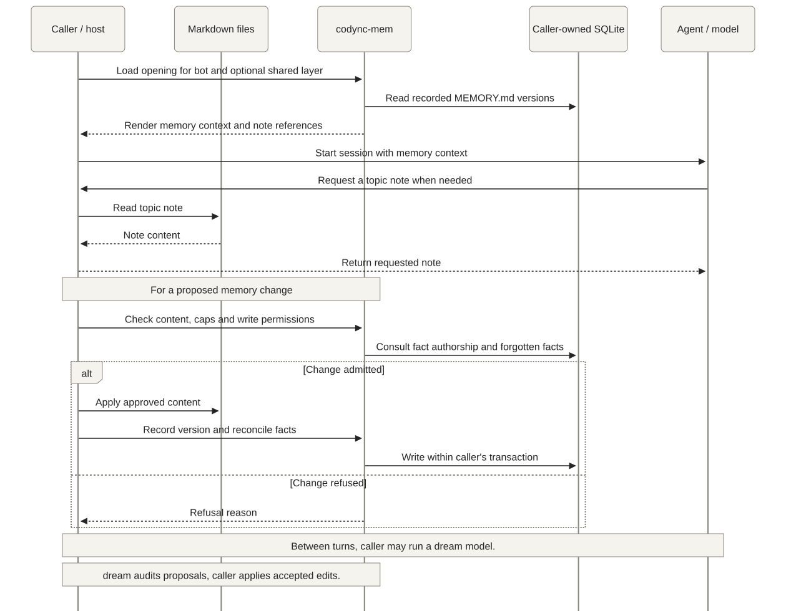

<div align="center">


# codync-mem

**Memory that stays with your agents.**<br>
Layered Markdown memory, clear write rules, and a record of every change.

[Quick start](#use) · [Architecture](#architecture) · [API reference](https://docs.rs/codync-mem) · [Codync](https://github.com/leepokai/Codync) · [Contributing](#status)

[](https://crates.io/crates/codync-mem) [](https://github.com/leepokai/codync-mem/actions/workflows/ci.yml) [](https://docs.rs/codync-mem) [](LICENSE)

</div>

---

Specially designed for bot-based memory: the memory system the coding-agent bots in
[Codync](https://github.com/leepokai/Codync) run on, as a standalone crate.

- **It records the person, not the work.** Project knowledge stays in the harness's own files (`AGENTS.md`,
  `CLAUDE.md`); the full conversation stays in your transcript.
- **Memory is Markdown files the bot keeps.** Each layer ("yours", shared by every bot, and each bot's own) is a
  folder: `MEMORY.md`, one short fact per line, which a session opens with in full within a token cap, and notes
  on one topic each in topic folders (`health/allergies.md`), read when it comes up, the way a project keeps its
  `CLAUDE.md` short and its `docs/` detailed. The bot edits them like any file; dreaming moves detail out of a
  nearly full `MEMORY.md` into the notes and leaves one line per topic pointing to its note
  (`Allergic to peanuts → health/allergies.md`), so memory is never full.
- **Rules for what a bot may change.** What every change a bot or dreaming makes brings in passes deterministic
  checks: no hidden characters, prompt-carrying links, planted instructions or secrets, and the caps. Outside a turn the user started
  in the bot's own chat, a bot only adds lines; what the user had it forget doesn't come back unless they ask
  again. The crate keeps every version and who wrote each fact.

The crate decides; the caller acts. It starts no processes, opens no network connections, calls no models and
spawns no threads. It keeps its own tables on the caller's SQLite connection and writes inside the caller's
transaction, so a memory change commits together with whatever the caller records alongside it.

## Architecture

The caller owns execution: file reads and writes, model calls, scheduling, and the SQLite connection
and transaction. `codync-mem` validates changes, records their history, and prepares memory context.



Markdown files are the live copy on disk. SQLite records versions, authorship and forgotten facts;
it is also where `opening` reads the recorded memory for a session. The caller keeps disk changes
and recorded versions in step. The SQLite transaction covers database records, not filesystem writes.

### From session context to a memory change



A session receives its bot's `MEMORY.md` and, when enabled, the shared “yours” layer. Topic notes
are read as needed. Dreaming follows the same ownership boundary: the crate builds a prompt and
audits the answer; the caller runs the model, checks the files still match the snapshot, applies
accepted edits and records the run. The crate does not run a background model or write files itself.

Diagram sources: [architecture](assets/architecture.mmd) · [memory flow](assets/memory-flow.mmd).
Render the Mermaid sources with the shared [theme](assets/diagram-theme.json) and a white background.

## Status

0.x, developed inside Codync and mirrored here read-only. The API changes with Codync. Report issues here;
send pull requests to [Codync's `dev` branch](https://github.com/leepokai/Codync) (`host/crates/memory`).

## Use

```sh
cargo add codync-mem
```

```rust
use codync_mem::rusqlite::Connection;

let mut conn = Connection::open_in_memory()?;
codync_mem::schema::migrate(&conn)?;
```

The crate re-exports the `rusqlite` it builds against: use that one, because a build can link only one
`rusqlite` to `sqlite3`.

It links the system SQLite. Where there is none (a fresh Ubuntu fails with `cannot find -lsqlite3`), install
`libsqlite3-dev` or build SQLite in with the same `rusqlite`:

```sh
cargo add rusqlite@0.40 --features bundled
```

## Modules

- `files`: the files of a layer. You keep them on disk; the crate keeps every version (content, author, cause),
  who wrote each fact of `MEMORY.md` and what it was learned from, checks what a change brings in
  (`check_change`), decides what a bot may change (`admit`) and what the user had it forget (`settle`), searches
  them, and renders the notes' index (`index`).
- `store`: tombstones of what the user had a bot forget, and the error type.
- `check`: the deterministic checks every change but the user's own passes.
- `opening`: the memory a session opens with (each `MEMORY.md` the bot sees), rendered for the instructions.
- `dream`: between turns, a job for the user's own model (`prompt`), the rules that audit its answer (`audit`,
  quotes of the user's own words only), the files' new content (`edits`, read-only: you write the files and mark
  each review's rewrite with `mark_reviewed`), and the run's log. When a `MEMORY.md` is nearly full (`full`), a
  run also tidies it into the notes of their topics.
- `legacy`: the memory entries of codync-mem 0.1, read once to move them into files.
- `evidence`: what counts as the user's own words (not pasted, quoted or forwarded text).
- `compaction`: when to summarize a conversation ahead of time, the loop guard, the keep-list and the handoff to
  a fresh conversation.
- `tokens`: the token estimate the caps count in (one per CJK character, one per four others).

## License

Apache-2.0
