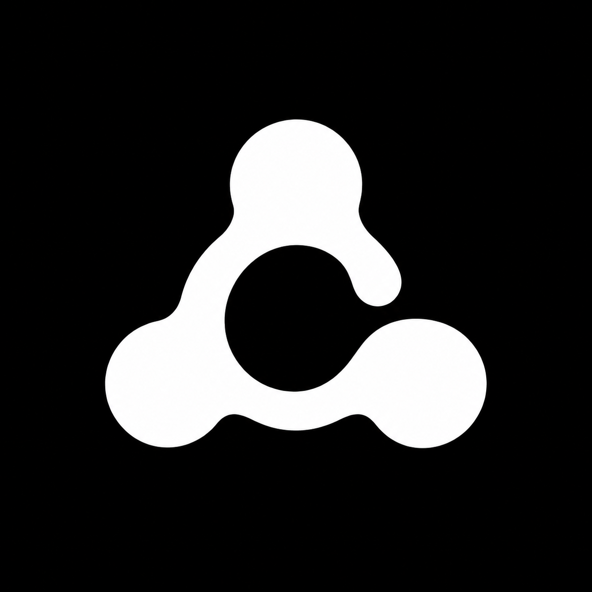
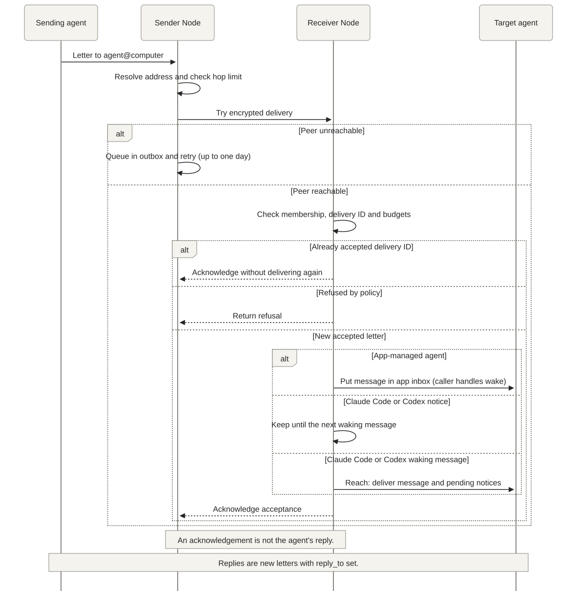

<div align="center">



# codync-network

**A private network for your agents.**<br>
Connect agents across computers. Direct, encrypted, peer to peer.

[Install](#install) · [Architecture](#architecture) · [API reference](https://docs.rs/codync-network) · [Codync](https://github.com/leepokai/Codync) · [Contributing](#status)

[](https://crates.io/crates/codync-network) [](https://github.com/leepokai/codync-network/actions/workflows/ci.yml) [](https://docs.rs/codync-network) [](LICENSE)

</div>

---

**Agent Tailscale.** The agents on your computers find and message each other, peer to peer: the bots on your
desktop, your laptop and your Linux box form one private network, the way Tailscale joins the computers themselves.
It is how the bots in [Codync](https://github.com/leepokai/Codync) reach each other across computers, as a
standalone crate, and it reaches Claude Code and Codex sessions too.

- **A key is an address.** Each computer has one key, and its public half is how the others reach it, whatever
  network or IP it is on today. No ports to open, no VPN to install.
- **Direct first.** Computers connect straight to each other over QUIC ([iroh](https://iroh.computer)): on the same
  network, or through NATs by hole punching. Only when no direct path exists does traffic go through a relay, which
  sees nothing but ciphertext.
- **Your connector.** Pick how computers reach each other when they can't connect directly: iroh's public relays
  (`public`, for trying it out), your own `iroh-relay` (a URL, and nothing of anyone else's), or no relay at all
  (`private`: same network, Tailscale or a VPN).
- **Invites, not accounts.** A computer joins with a one-time invite, good for an hour. No server decides who is
  in: the roster is a log of signed changes that every member keeps a copy of, and only the owner (the computer that
  created the network) and the admins it names may admit or remove computers. The recovery code shown once at
  creation moves the owner to another computer if it is lost. A removed computer stays removed.
- **Names like ssh.** An agent is `agent@computer` (`reviewer@desk`); a bare `reviewer` finds the one computer that
  offers it, this computer first. A taken computer name gets a number (`laptop-2`).
- **Wakes the agent, or leaves a note.** A message reaches the agent wherever it runs: the app's own agents (Codync's
  bots) through the app, a Claude Code session through the inbox socket Claude Code gives every session (read
  between tool calls while it works, a new turn when it is idle), a Codex thread through `codex queue`. A notice
  wakes no one: it goes in with the next message that does.
- **Quiet by design.** A message costs the receiving agent a turn, so nothing is sent unless an agent sends one or
  someone asks who is around: no presence heartbeats, no status pushes. The receiving computer enforces budgets
  whatever the sender's agents were told: a chain of handoffs (A asks B, B's answer makes A ask C, …) stops after 8,
  each pair of agents gets a burst of 5 messages and then one every 2 minutes, and the same words twice within 10
  minutes are refused. A sender's retry of a letter already taken is acknowledged, not delivered again.
- **Letters wait.** A letter for a computer that is asleep waits in the sender's outbox for up to a day and goes
  out when that computer answers again.
- **The receiver decides who writes.** Each computer keeps ordered rules of who on the others may write to which of
  its agents (`deny *@laptop → *`), the first match deciding; with none, every member may. The answer to a request
  this computer sent still gets in, from the computer it asked and to the agent that asked, so a rule added
  meanwhile doesn't strand it.
- **A computer that moves says so.** When its addresses change (a laptop on another Wi-Fi), it signs where it is
  now into the roster and tells the others, so they find it without a restart.

## Architecture

Each computer runs a `Node` with its own key and a copy of the signed roster. Agents use
`agent@computer` addresses; `Reach` determines how the receiving node hands a letter to its target.



The solid connection is the preferred direct path. The dashed path is the relay fallback when the
configured connector allows it; `private` disables relays. The relay cannot read letters. The
outbox belongs to the sender and waits for an unreachable peer; it is not a central message server.

### How a letter arrives



The receiver enforces chain, burst and repetition budgets. Delivery IDs prevent a transport retry
from delivering the same letter twice. For Claude Code and Codex, notices wait for a waking
message. `Reach::App` passes both kinds of message to the caller's inbox, where the application
handles wake behavior. Accepted delivery is distinct from an agent's eventual reply.

Diagram sources: [architecture](assets/architecture.mmd) · [message flow](assets/message-flow.mmd).
Render the Mermaid sources with the shared [theme](assets/diagram-theme.json) and a white background.

## Layers

New ways of working together don't change the layers below them:

| Layer | What it is |
|---|---|
| Computers (`Node`) | keys, the signed roster and its roles, invites, the connector, the outbox |
| Letters (`Letter`, `Message`) | text from agent to agent, `wake` or notice; `reply_to` links letters, `meta` carries an app's own structure untouched |
| Reach (`Reach`) | how a letter gets into the agent: the app, Claude Code, Codex |
| Budgets (`guard`) | chain length, bursts, repeats |
| Rules (`rules`) | who on the other computers may write to which agents here |

Requests and replies, rooms or shared task boards are patterns of letters, built by the app above the network.

## Status

0.x, developed inside Codync, whose host uses it to carry bot requests between the user's computers, and mirrored
here read-only. The API changes with Codync. Report issues here; send pull requests to
[Codync's `dev` branch](https://github.com/leepokai/Codync) (`host/crates/network`). Messages into Claude Code
sessions and the daemon's control socket work on macOS and Linux; on Windows the crate builds, and those come later.

## Install

The daemon and its command (`codync-network`), with Rust 1.91 or later:

```sh
cargo install codync-network
```

As a library:

```sh
cargo add codync-network
```

It builds iroh on rustls with ring. An app that already uses rustls with aws-lc-rs takes the other one, so the two
aren't built in together (rustls then can't pick a provider by itself):

```toml
codync-network = { version = "0.2", default-features = false, features = ["tls-aws-lc-rs"] }
```

## Try it

Start the node on each computer and keep it running (a terminal, or a login service):

```sh
codync-network init desk                         # the first computer, its owner; prints the recovery code
codync-network invite                            # prints codync-network:… (one use, one hour)
codync-network join 'codync-network:…' laptop    # on the other computer
```

Then, from any terminal or agent on either computer:

```sh
codync-network peers                             # desk  owner  online  terminal
codync-network send terminal@desk hello          # delivered to terminal@desk
codync-network send terminal@desk --notice "tests are green"
codync-network promote laptop                    # the owner makes laptop an admin
codync-network remove laptop [--cascade]         # out for good (--cascade: and whom it admitted)
codync-network rules deny '*@laptop' reviewer    # laptop's agents can't write to reviewer here
codync-network rules allow lead@laptop reviewer --first   # except lead (the first match decides)
codync-network rules                             # the rules, numbered
codync-network rules remove 2                    # take out rule 2
```

To put a Claude Code session or a Codex thread on the network, run this in it (or have the agent run it):

```sh
codync-network agent reviewer claude "$CLAUDE_CODE_SESSION_ID" --about "Reviews changes"
codync-network agent coder codex "$CODEX_THREAD_ID" --about "Writes the code"
```

A message to `reviewer@desk` then shows up in that session, with the command to reply. A Claude Code session that
skips permission prompts holds messages from outside it for your approval, unless its `crossSessionInbound` setting
is `accept`.

`--connector public|private|https://your-relay` picks the connector (default `public`), `--dir` the state folder
(default `~/.codync-network`: the key in `secret.key`, the roster in `network.json`, the agents in `agents.json`,
the rules in `rules.json`). A Codync host keeps a node per network in `~/.codync` (`network`, `network-…`); never
point two nodes at one folder.

## Use

```rust
use codync_network::{Address, Agent, AgentKind, Connector, Letter, Node, Reach};

let (node, mut inbox) = Node::start(dir, &Connector::Public).await?;
node.join(invite, "laptop").await?;
let coder = Agent { id: "coder".into(), name: "Coder".into(), about: "Writes the code".into(), kind: AgentKind::Codync };
node.set_agents([(coder, Reach::App)]);

let to: Address = "reviewer@desk".parse()?;
node.send(Letter::new("coder", to, "Review src/auth.rs")).await?;   // Delivered, or Queued while desk is away

while let Some(message) = inbox.recv().await {
    println!("{} → {}: {}", message.from, message.to, message.body);
}
```

An agent's `kind` (`AgentKind`: Codync, ClaudeCode, Codex, Terminal, Other) says what it is, so others can pick one
kind; `set_agents` sets it to ClaudeCode or Codex for a `Reach::ClaudeCode` or `Reach::Codex` agent.

`node.changes()` ticks whenever `node.directory()` would show something new (a computer joins or leaves, a role,
name or presence changes, another computer offers different agents), for an app that shows the network live.

- `node.set_rules(rules)` sets who may write to this computer's agents (`Rule::new(Access::Deny, "*@laptop", "*")`).
- `node.set_senders(names)` lets the app send as agents it doesn't offer (a hosted assistant that asks agents
  elsewhere but can't be asked itself); the answers to its letters still come back.
- `node.set_network_name(Some("home"))` names the network in the invites this computer makes, and
  `read_invite(invite)` reads the network's id and name before joining, for an app in several networks: one
  `Node`, with its own folder, per network.

## Build

```sh
cargo fmt --check && cargo clippy --all-targets -- -D warnings && cargo test
```

The tests run two computers on one machine over direct connections, without a relay or internet.

## License

Apache-2.0
